<div align="center">


<br />

[](../../releases/latest)
[](../../releases)
[](../../releases/latest)
[](LICENSE)
[](https://ko-fi.com/cristhianbillybustamante)

[🇪🇸 Español](README.md) · **🇬🇧 English**

<h3>
  <a href="../../releases/latest">⬇️ Download Noki for Windows</a>
  &nbsp;·&nbsp;
  <a href="#-getting-started">Getting started</a>
  &nbsp;·&nbsp;
  <a href="#-features">Features</a>
</h3>

</div>

<br />

**Noki** lives at the top of your screen like the notch of a Mac. Hover over it (or press `Alt+N`) and it opens into a panel with everything you use every day: your music, tasks, habits, files, the weather and a lot more. When you don't need it, it shrinks and almost disappears.

It is **free, open source and runs fully on your PC**: no accounts, no telemetry.

<div align="center">
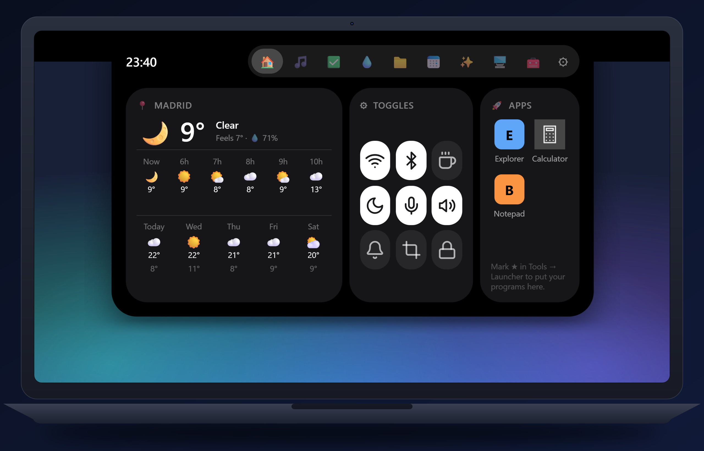
</div>

## ✨ Why Noki?

| Advantage | What it means |
|---|---|
| 🎯 **Everything one gesture away** | One place for music, tasks, calendar, weather, files, translator and more — without opening ten windows |
| 🪟 **Plays nicely with your windows** | It registers like a Windows bar: other windows work below it, and it hides by itself in full screen |
| 🎨 **Made your way** | Change its color or give it an image, make it follow the color of the app below it, and choose what it shows when closed |
| 🔒 **Private** | Your data stays on your PC. API keys go to the Windows Credential Manager |
| 🌐 **English and Spanish** | Switch instantly in the settings |

## 📸 A quick look

<table>
<tr>
<td align="center" width="50%">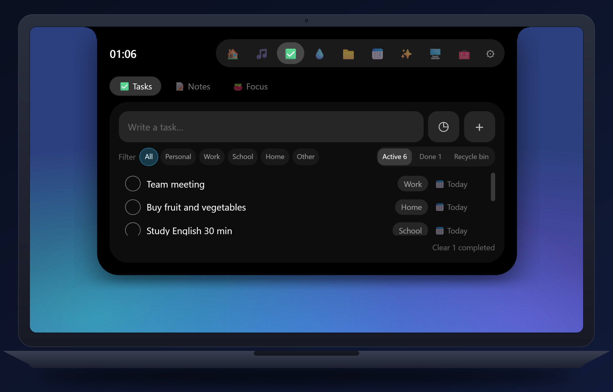<br /><sub><b>Planner</b> · tasks with date and category</sub></td>
<td align="center" width="50%">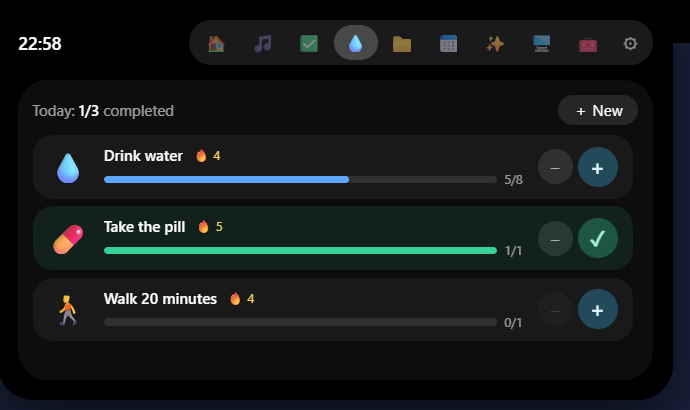<br /><sub><b>Habits</b> · goals, streaks and reminders</sub></td>
</tr>
<tr>
<td align="center" width="50%">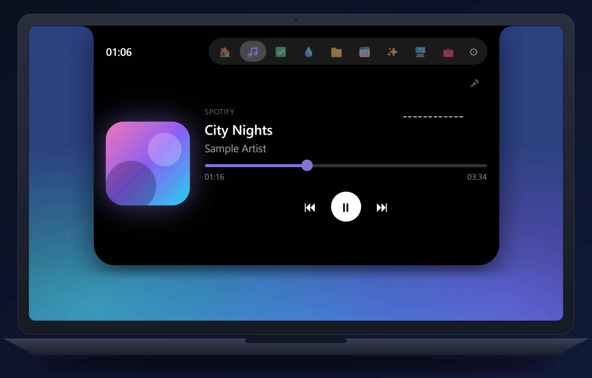<br /><sub><b>Music</b> · album art, progress and lyrics</sub></td>
<td align="center" width="50%">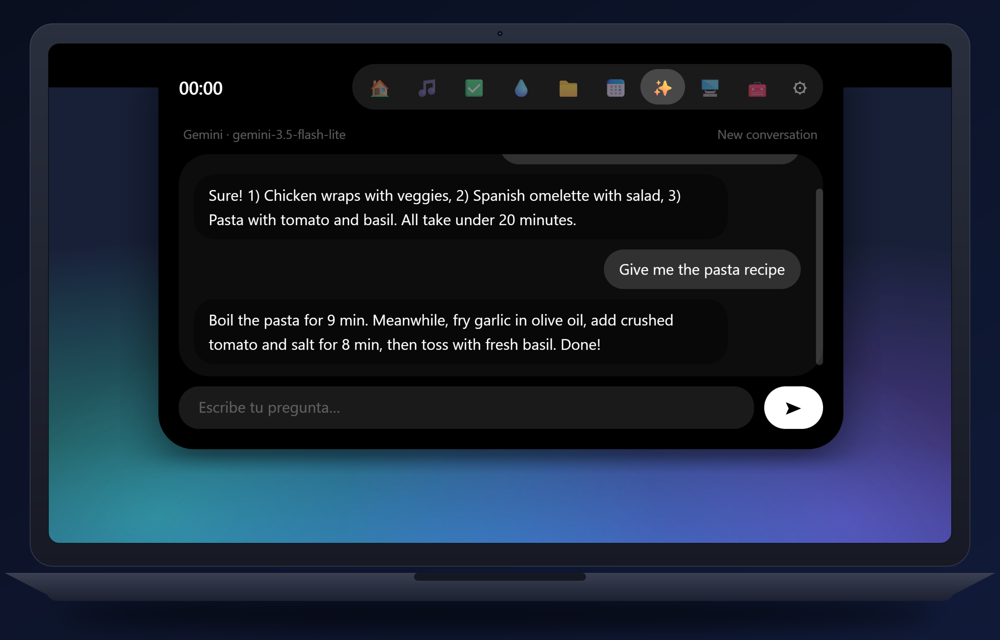<br /><sub><b>AI chat</b> · quick answers with your own key</sub></td>
</tr>
<tr>
<td align="center" width="50%">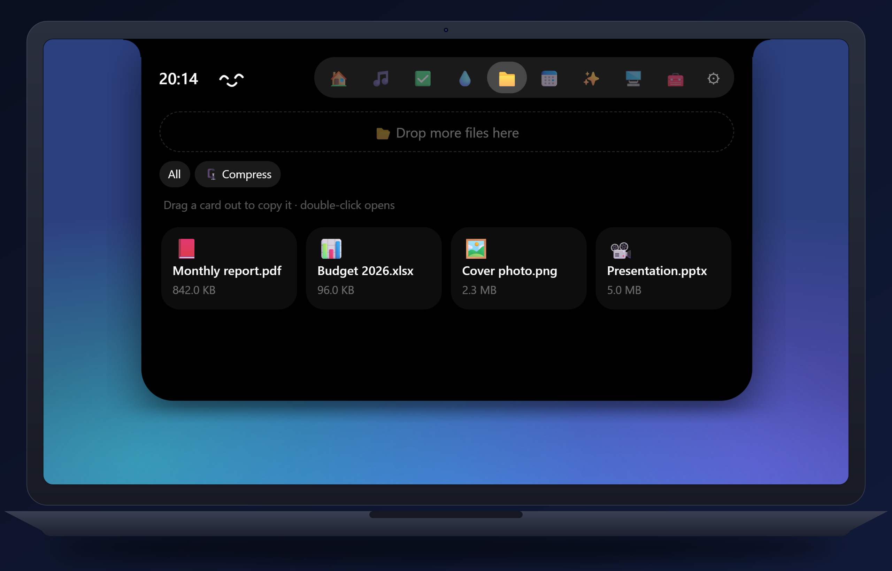<br /><sub><b>Files</b> · drop, drag out, compress and more</sub></td>
<td align="center" width="50%">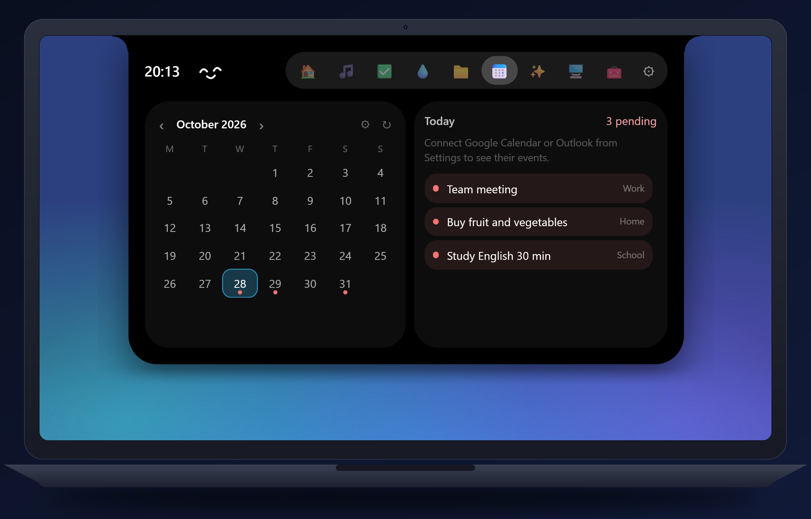<br /><sub><b>Calendar</b> · your tasks and events for the month</sub></td>
</tr>
<tr>
<td align="center" width="50%">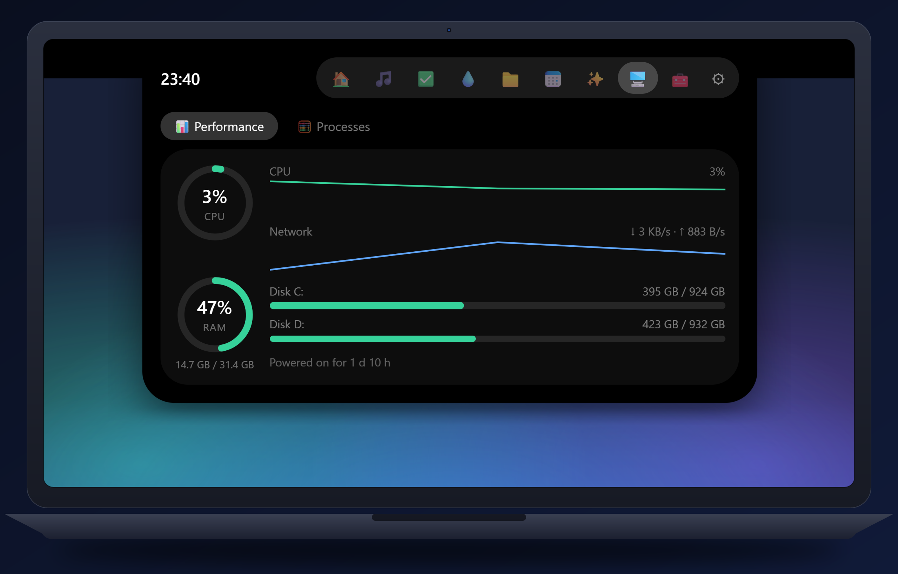<br /><sub><b>System</b> · CPU, RAM, disks and network</sub></td>
<td align="center" width="50%">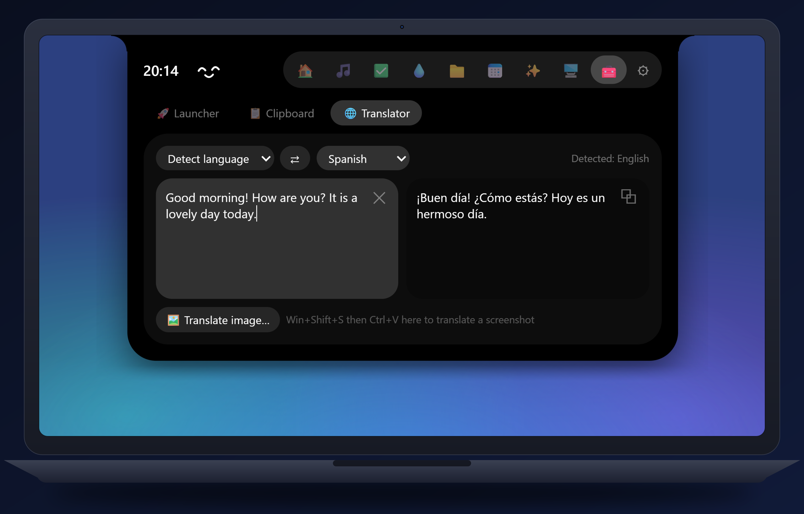<br /><sub><b>Translator</b> · text and images, no API key</sub></td>
</tr>
</table>

## 🧩 Features

<table>
<tr>
<td width="50%" valign="top">

**🏠 Panel**
One-tap toggles (Wi-Fi, Bluetooth, keep awake, dark mode, microphone, sound, Do not disturb, screenshot and lock), the weather by hour and day, and your favorite apps with their real icons.

**🎵 Music**
Shows and controls whatever is playing (Spotify, YouTube Music, VLC, your browser…): album art, seek bar, **synced lyrics** and a visualizer that reacts to your real sound.

**✅ Planner**
Tasks with date, time and category. Type “call 15m” or “meeting 14:30” and it understands. Includes quick notes and a **Pomodoro** timer.

**💧 Habits**
Drink water, take a pill, go for a walk… with a daily goal, **streaks** and reminders. Turn each habit on or pause it.

**📁 Files**
Drop files on the notch to keep them; drag them back out, compress, extract, copy, move or send them to the recycle bin.

</td>
<td width="50%" valign="top">

**📅 Calendar**
Month view with your tasks and events from Google, Outlook or any iCal link, and alerts before meetings.

**✨ AI chat**
A quick chat for questions and short answers (Gemini, Claude, OpenAI-compatible or local Ollama). It keeps answering in the background. You use your own key.

**🌐 Translator**
Translates text as you type and **images too** (with the Windows OCR, on your PC). No API key needed.

**🖥️ System**
CPU, RAM, disks and network in real time, and the programs using the most, with a button to close them.

**⏱️ Screen time**
*Optional, off by default.* How long you use each app, only on your PC.

**🔔 Alerts and more**
Volume, brightness, charger, low battery, internet, Caps Lock, health reminders, one notch per screen and signed updates.

</td>
</tr>
</table>

## 🚀 Getting started

1. **Download** `Noki_<version>_x64-setup.exe` from [Releases](../../releases/latest) and run it. It installs for your user only (no administrator rights). If Microsoft Edge WebView2 is missing, the installer downloads it.
2. **Open Noki** from the Start menu. You'll see a small notch at the top center of your screen and its icon in the tray (left click = Settings, right click = menu).
3. **Hover over it** or press **`Alt+N`** to open it. Click the icons at the top to switch tabs.
4. Open **Settings** (⚙) to turn modules on or off, choose the language, change its look and connect your calendar, your city or your AI key.

> **Windows SmartScreen warning:** the installer is not yet signed with a paid code-signing certificate, so Windows may show “Windows protected your PC”. That's normal: choose **More info → Run anyway**. If you'd rather not, you can [build it yourself](#-build-from-source).

Your settings live in `%APPDATA%\com.noki.app`. If you are coming from “Mi Notch” (the previous name), Noki copies your settings, data and keys the first time it opens; afterwards you can uninstall the old version.

## 🎨 Make it yours

In **Settings → Appearance** you can:

- Pick the notch **color** or give it a background **image**.
- Turn on **automatic color**: it takes the color of the app open underneath and changes with it.
- Fill the **strip beside the notch** so it looks like a single piece (same as the notch, transparent, a color, an image or automatic).
- Decide **what shows when it's closed**: time, date, pending tasks, today's habits, temperature, battery and what's playing.
- Adjust sizes, position, opacity and a 12 or 24-hour clock.

<table>
<tr>
<td align="center" width="50%">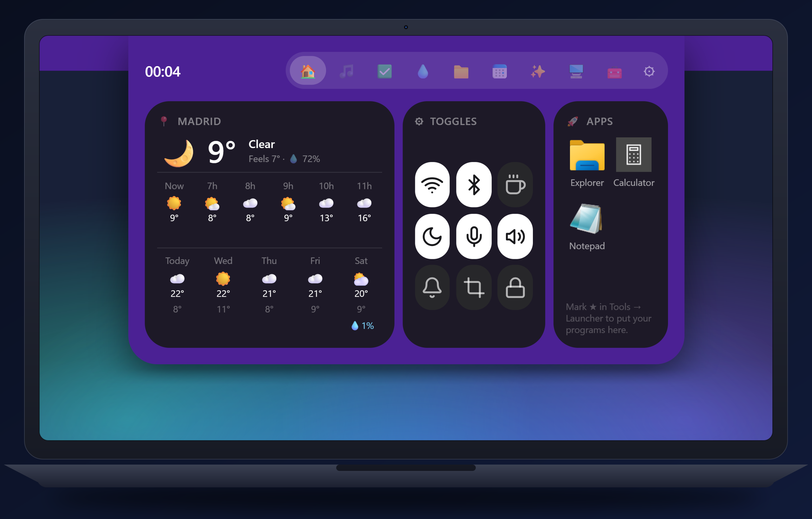<br /><sub><b>A color</b> · the notch and the strip to match</sub></td>
<td align="center" width="50%">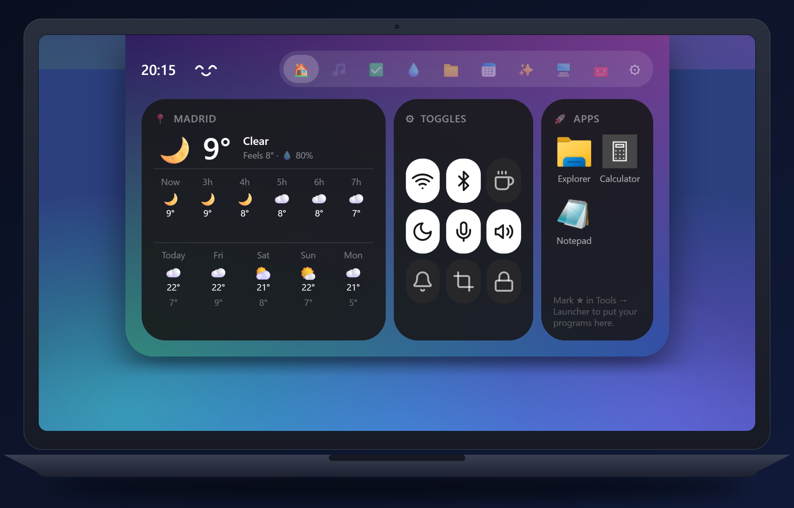<br /><sub><b>An image</b> · as the background of the notch and the strip</sub></td>
</tr>
<tr>
<td align="center" width="50%">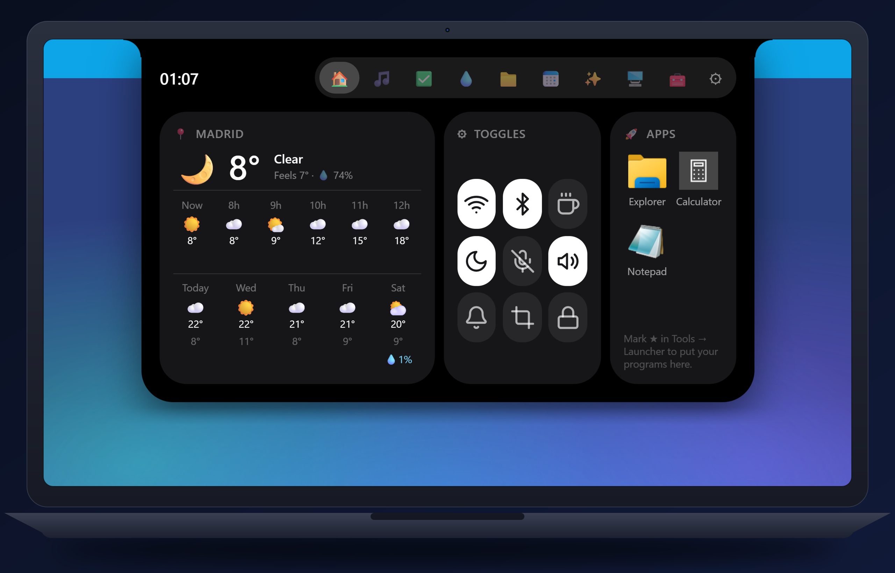<br /><sub><b>The strip your way</b> · the sides of the notch can be another color, an image or transparent</sub></td>
<td align="center" width="50%">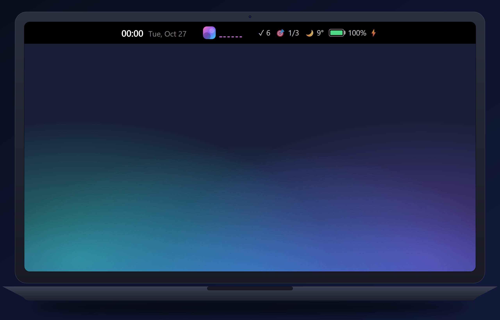<br /><sub><b>Closed</b> · time, tasks, habits, weather, battery and what's playing</sub></td>
</tr>
</table>

## 🔌 And much more

- **Calendars by link.** Add any calendar that gives you an `.ics` or `webcal://` address. In Google Calendar: Settings → your calendar → “Integrate calendar” → “Secret address in iCal format”. In Outlook: Settings → Calendar → Shared calendars → “Publish a calendar”. They are read-only and refresh every 15 minutes.
- **Backup.** In Settings → About you can **export** your settings and data (tasks, notes, habits, chat…) to a file and **import** them on another PC. API keys are not included.
- **AI chat your way.** Pick Gemini, Claude, an OpenAI-compatible service or Ollama on your own machine. Keys are kept in the Windows Credential Manager.
- **One shortcut for everything.** `Alt+N` opens and closes the notch (you can change it in Settings → Shortcuts).
- **Useful alerts.** Volume, brightness, charger, low battery, internet, Caps Lock and health reminders, each with its own switch.
- **Several screens.** One notch per monitor, and it hides by itself when something goes full screen.

## 🔐 Privacy

Everything stays on your PC. Noki only goes online when you use something that needs it:

| Feature | Service | When |
|---|---|---|
| Weather | [Open-Meteo](https://open-meteo.com) | when a city is set |
| Text translation | Google Translate web service (unofficial endpoint) | while you translate |
| Image text (OCR) | Windows built-in OCR, **local** | nothing leaves your PC |
| Lyrics | [LRCLIB](https://lrclib.net) | when you open lyrics |
| Detect my city | [ipwho.is](https://ipwho.is) | only when you press the button |
| AI chat | the provider you choose, with *your* key | when you send a message |
| Calendars | the iCal links you add | every 15 minutes |
| Updates | GitHub Releases | on start and every 6 h, if enabled |

## 🛠️ Build from source

Requirements: Windows 10/11, [Node.js 20+](https://nodejs.org), [Rust (stable)](https://rustup.rs) and the Visual Studio Build Tools with the “Desktop development with C++” workload.

```bash
npm install
npm run tauri dev      # development mode with hot reload
npm run tauri build    # builds the NSIS installer
```

Tests: `cd src-tauri && cargo test --lib`. To publish versions with automatic updates see [docs/RELEASING.md](docs/RELEASING.md) (**never commit your private signing key**).

<details>
<summary><b>How it works inside</b></summary>

- A fixed-size transparent window per monitor; a Rust thread reads the cursor every 25 ms to decide click-through, hover open/close and full-screen hiding.
- With “Reserve space” it registers as a Windows AppBar, so maximized windows stay below the notch.
- A React 18 + Tailwind interface that talks to Rust through Tauri 2 commands and events.

| Path | What it does |
|---|---|
| `src-tauri/src/notch.rs` | Position, AppBar, click-through, hover and full screen |
| `src-tauri/src/dropzone.rs` | Native drop target for dragging files onto the notch |
| `src-tauri/src/quick.rs` | Panel toggles |
| `src-tauri/src/settings.rs` | Typed settings, validation and atomic saving |
| `src/App.jsx` | The notch (shape, tabs, animation) |
| `src/components/SettingsWindow.jsx` | The Settings window |
| `src/lib/en.js` | English translations |

</details>

## 🤝 Contributing

Bug reports and ideas are very welcome: open an [issue](../../issues/new/choose), chat in [Discussions](../../discussions) or read [CONTRIBUTING.md](CONTRIBUTING.md).

## 💛 Support the project

Noki is free. If you like it, you can **[buy me a coffee on Ko-fi](https://ko-fi.com/cristhianbillybustamante)** ☕ or just follow along:

[Instagram](https://www.instagram.com/cristhian.billy/) · [Facebook](https://www.facebook.com/cristhian.bustamanteespinoza/) · [X](https://x.com/Cristhian_0702)

## 🙏 Credits

- Made by **Cristhian Bustamante** with the help of AI ([Claude Code](https://claude.com/claude-code)).
- Inspired by the notch of Mac laptops and by desktop “notch” apps — that idea encouraged me to make my own version.
- Built on open-source software, see [THIRD-PARTY-NOTICES.md](THIRD-PARTY-NOTICES.md).

## 📄 License

Copyright © 2026 Cristhian Bustamante. Noki is free software: you can redistribute it and/or modify it under the terms of the [GNU General Public License v3.0 or later](LICENSE). It comes with **no warranty**.

<div align="center">
<br />
<sub>Made with ☕ and lots of love · If Noki is useful to you, give the repo a ⭐!</sub>
</div>
