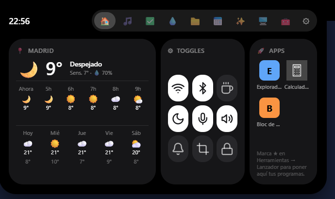
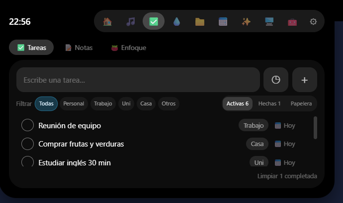
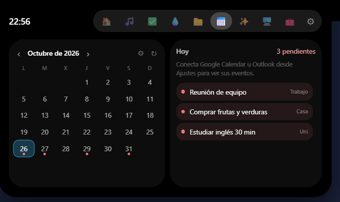

<div align="center">


# Noki

**Un notch amigable para tu escritorio de Windows.**
Música, tareas, archivos, calendario, clima, interruptores rápidos, un chat de IA veloz y un traductor, todo dentro de un pequeño notch personalizable en la parte superior de tu pantalla.

[English](README.md) · [Español](README.es.md)

[](LICENSE)

[](https://ko-fi.com/cristhianbillybustamante)

</div>

---

## ¿Qué es Noki?

Noki se queda arriba de tu pantalla como el notch de una Mac. Pasa el cursor por encima (o pulsa `Alt+N`) y se abre en un
pequeño panel. Las demás ventanas trabajan *por debajo*, como con una barra de tareas, y se oculta solo cuando pones algo a
pantalla completa.

Es gratis, de código abierto y funciona por completo en tu PC. Sin cuentas ni telemetría.

## Funciones

| | |
|---|---|
| 🏠 **Panel** | Interruptores de un toque (Wi-Fi, Bluetooth, mantener activo, modo oscuro, micrófono, sonido, No molestar, captura, bloquear), el clima con pronóstico por horas y por días, y tus apps favoritas con sus iconos reales |
| 🎵 **Música** | Muestra y controla lo que suene (Spotify, YouTube Music, VLC, el navegador…), carátula, barra de progreso, letras sincronizadas y un visualizador que reacciona a tu sonido real |
| ✅ **Agenda** | Tareas con fecha, hora, categoría y recordatorios (escribe «llamar 15m» o «reunión 14:30»), notas rápidas y un temporizador Pomodoro |
| 💧 **Hábitos** | Hábitos diarios con meta, rachas y recordatorios: tomar agua, la pastilla, caminar, leer… Activa o apaga cada hábito (o todo el módulo) |
| 🖥️ **Sistema** | CPU, RAM, discos y red en tiempo real, y los programas que más memoria o CPU usan (con botón para cerrarlos) |
| ⏱️ **Tiempo de pantalla** | *Opcional, apagado por defecto.* Cuánto usas cada app hoy y en 7 días. Se queda en tu PC y no cuenta cuando estás ausente |
| 📁 **Archivos** | Suelta archivos en el notch para guardarlos en un estante; arrástralos de vuelta, comprímelos, extráelos, cópialos, muévelos o mándalos a la papelera |
| 📅 **Calendario** | Vista mensual con tus tareas y eventos (Google, Outlook o cualquier enlace iCal) y avisos antes de las reuniones |
| ✨ **Chat de IA** | Un chat rápido para respuestas veloces (Gemini, Claude, compatibles con OpenAI u Ollama local) que sigue respondiendo en segundo plano. Usas tu propia clave de API |
| 🧰 **Herramientas** | Lanzador de apps, historial del portapapeles (opcional) y un **traductor** de texto e imágenes, sin clave de API |
| 🎨 **Tu diseño** | Color o imagen para el notch, color automático que sigue al programa de abajo, franja a los costados, y elige qué se ve cerrado (hora, fecha, tareas, temperatura, batería…) |
| 🌐 **Idiomas** | Español e inglés |
| 🔔 **Avisos** | Volumen, brillo, cargador, batería baja, internet, dispositivo de audio, Bloq Mayús, idioma del teclado y recordatorios de salud |
| 🖥️ **Varias pantallas** | Un notch por pantalla (opcional) |
| 🔄 **Actualizaciones** | Actualizaciones firmadas que apruebas tú |

## Capturas

<table>
<tr><td align="center"><br><sub>Panel</sub></td><td align="center"><br><sub>Agenda</sub></td></tr>
<tr><td align="center"><br><sub>Hábitos</sub></td><td align="center"><br><sub>Calendario</sub></td></tr>
<tr><td align="center"><br><sub>Sistema</sub></td><td align="center"><br><sub>Traductor</sub></td></tr>
</table>

## Instalar

1. Descarga `Noki_<versión>_x64-setup.exe` desde la página de [Releases](../../releases).
2. Ejecútalo. Se instala solo para tu usuario (no pide administrador). Si falta Microsoft Edge WebView2, el instalador lo descarga.
3. Abre **Noki** desde el menú Inicio. Su icono aparece en la bandeja: clic izquierdo = Ajustes, clic derecho = menú.

> **Windows SmartScreen:** el instalador todavía no está firmado con un certificado de pago, así que Windows puede mostrar
> «Windows protegió su PC». Elige **Más información → Ejecutar de todas formas**. También puedes compilarlo tú mismo (abajo).

Tus ajustes están en `%APPDATA%\com.noki.app`. Las claves de API se guardan en el **Administrador de credenciales de Windows**, nunca en archivos ni en copias de seguridad.

### ¿Vienes de «Mi Notch»?
Noki es el nuevo nombre de Mi Notch. La primera vez que se abre copia sola tus ajustes, datos y claves guardadas.
Después puedes desinstalar la versión anterior.

## Privacidad

Todo se queda en tu PC. Noki solo se conecta a internet cuando usas algo que lo necesita:

| Función | Servicio | Cuándo |
|---|---|---|
| Clima | [Open-Meteo](https://open-meteo.com) | si eliges una ciudad |
| Traducción de texto | Servicio web de Google Translate (punto de acceso no oficial) | mientras traduces |
| Texto de imágenes (OCR) | OCR de Windows, **local** | nada sale de tu PC |
| Letras | [LRCLIB](https://lrclib.net) | al abrir las letras |
| Detectar mi ciudad | [ipwho.is](https://ipwho.is) | solo al pulsar el botón |
| Chat de IA | el proveedor que elijas, con *tu* clave | al enviar un mensaje |
| Calendarios | los enlaces iCal que añadas | cada 15 minutos |
| Actualizaciones | la dirección que configures (p. ej. GitHub Releases) | al abrir / cada 6 h, si está activado |

## Compilar desde el código

Requisitos: Windows 10/11, [Node.js 20+](https://nodejs.org), [Rust (estable)](https://rustup.rs) y las
Visual Studio Build Tools con la carga «Desarrollo de escritorio con C++».

```bash
npm install
npm run tauri dev      # modo desarrollo con recarga
npm run tauri build    # genera el instalador NSIS (sin firmar para actualizaciones)
```

Para un instalador firmado con actualizaciones automáticas, crea tu propia clave
(`npx tauri signer generate -w %USERPROFILE%\.tauri\noki.key`), pon su clave pública en
`src-tauri/tauri.conf.json` y ejecuta `scripts\compilar.ps1`. **Nunca subas tu clave privada.**

Pruebas: `cd src-tauri && cargo test --lib`.

### Cómo funciona
- Una ventana transparente de tamaño fijo por pantalla; un hilo de Rust lee el cursor cada 25 ms para decidir el
  click-through, abrir/cerrar al pasar el cursor y ocultarse en pantalla completa.
- Con «Reservar espacio» se registra como AppBar de Windows, así las ventanas maximizadas quedan debajo del notch.
- Interfaz: React 18 + Tailwind, que habla con Rust mediante comandos y eventos de Tauri.

## Contribuir

Los reportes de errores y las ideas son muy bienvenidos; mira [CONTRIBUTING.md](CONTRIBUTING.md).

## Créditos

- Hecho por **[Cristhian Bustamante](https://www.instagram.com/cristhian.billy/)** con ayuda de IA (Claude Code).
- Inspirado en el notch de las laptops Mac y en las apps de «notch» para escritorio: gracias a esa idea me animé a hacer mi propia versión.
- Construido sobre software de código abierto; mira [THIRD-PARTY-NOTICES.md](THIRD-PARTY-NOTICES.md).

## Apoyo

Noki es gratis. Si te gusta, puedes [invitarme un café en Ko-fi](https://ko-fi.com/cristhianbillybustamante) ☕,
o simplemente seguirme: [Instagram](https://www.instagram.com/cristhian.billy/) ·
[Facebook](https://www.facebook.com/cristhian.bustamanteespinoza/) · [X](https://x.com/Cristhian_0702)

## Licencia

Copyright © 2026 Cristhian Bustamante.

Noki es software libre: puedes redistribuirlo y/o modificarlo bajo los términos de la
[Licencia Pública General de GNU v3.0 o posterior](LICENSE). Se ofrece **sin garantía**.
