<div align="center">

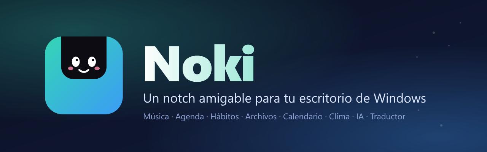

<br />

[](../../releases/latest)
[](../../releases)
[](../../releases/latest)
[](LICENSE)
[](https://ko-fi.com/cristhianbillybustamante)

**🇪🇸 Español** · [🇬🇧 English](README.en.md)

<h3>
  <a href="../../releases/latest">⬇️ Descargar Noki para Windows</a>
  &nbsp;·&nbsp;
  <a href="#-primeros-pasos">Primeros pasos</a>
  &nbsp;·&nbsp;
  <a href="#-funciones">Funciones</a>
</h3>

</div>

<br />

**Noki** vive en la parte de arriba de tu pantalla, como el notch de una Mac. Pasa el cursor por encima (o pulsa `Alt+N`) y se abre en un panel con todo lo que usas a diario: tu música, tus tareas, tus hábitos, tus archivos, el clima y mucho más. Cuando no lo necesitas, se encoge y casi desaparece.

Es **gratis, de código abierto y funciona por completo en tu PC**: sin cuentas, sin telemetría.

<div align="center">
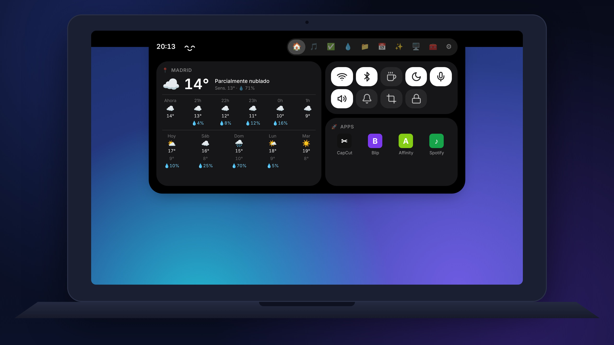
</div>

## ✨ ¿Por qué Noki?

| Ventaja | Qué significa |
|---|---|
| 🎯 **Todo a un gesto** | Un solo lugar para música, tareas, calendario, clima, archivos, traductor y más, sin abrir diez ventanas |
| 🪟 **Convive con tus ventanas** | Se registra como una barra de Windows: las demás ventanas trabajan por debajo y se oculta solo en pantalla completa |
| 🎨 **Hecho a tu gusto** | Cambia su color o ponle una imagen, haz que tome el color del programa que tengas abierto y elige qué muestra cuando está cerrado |
| 😊 **Con personalidad** | Una carita en el notch que parpadea, te sigue con la mirada y se alegra cuando terminas una tarea. Si no la quieres, se apaga |
| 🔒 **Privado** | Tus datos se quedan en tu PC. Las claves de API van al Administrador de credenciales de Windows |
| 🌐 **Español e inglés** | Cámbialo al instante en los ajustes |

## 📸 Un vistazo

<table>
<tr>
<td align="center" width="50%">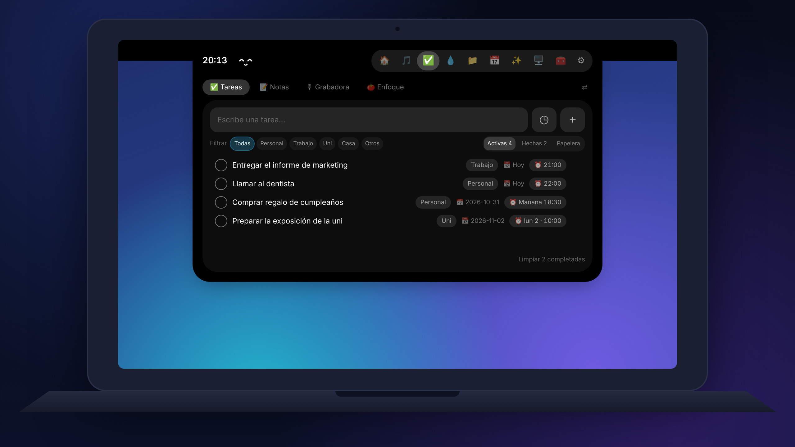<br /><sub><b>Agenda</b> · tareas con fecha y categoría</sub></td>
<td align="center" width="50%">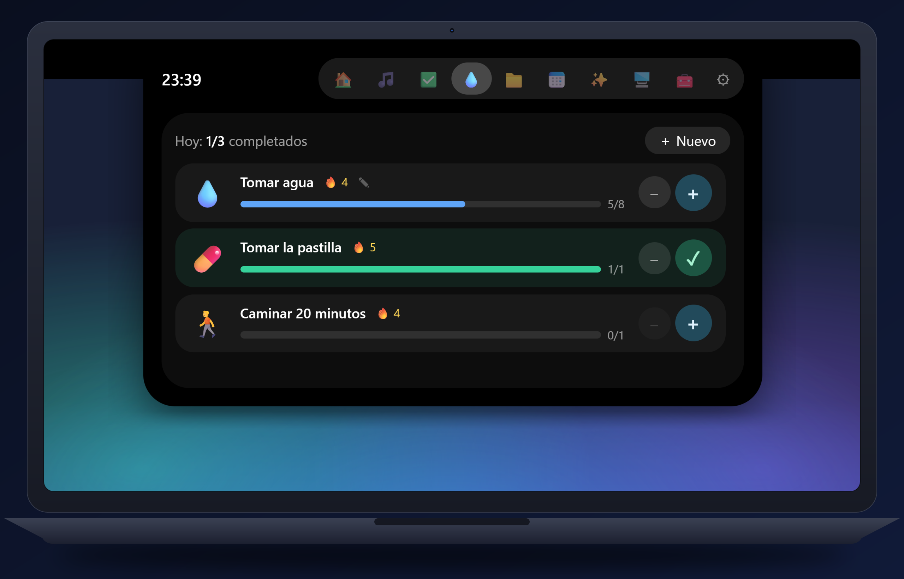<br /><sub><b>Hábitos</b> · metas, rachas y recordatorios</sub></td>
</tr>
<tr>
<td align="center" width="50%">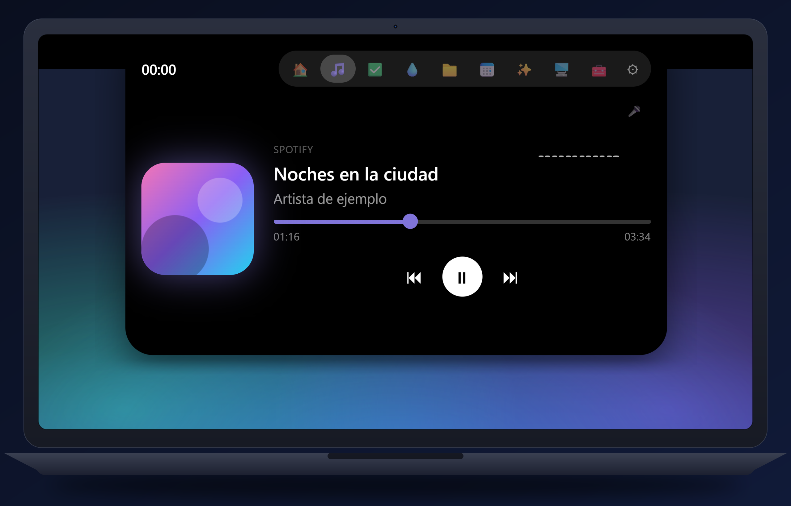<br /><sub><b>Música</b> · carátula, progreso y letras</sub></td>
<td align="center" width="50%">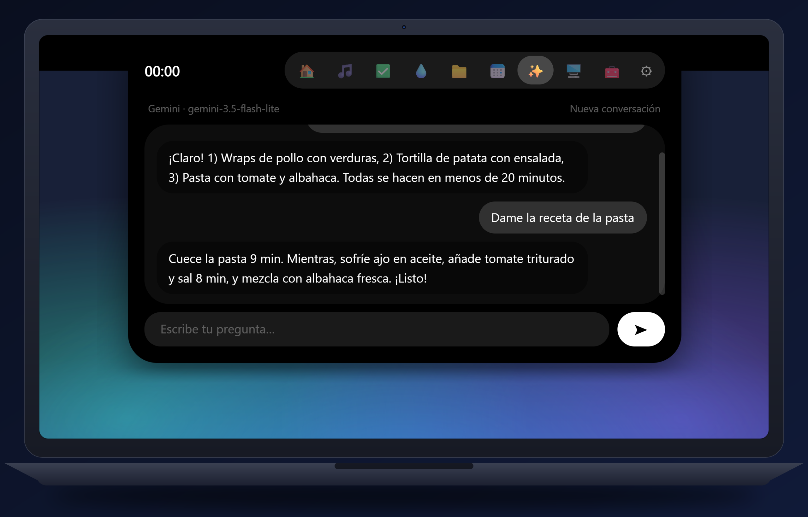<br /><sub><b>Chat de IA</b> · respuestas rápidas con tu propia clave</sub></td>
</tr>
<tr>
<td align="center" width="50%">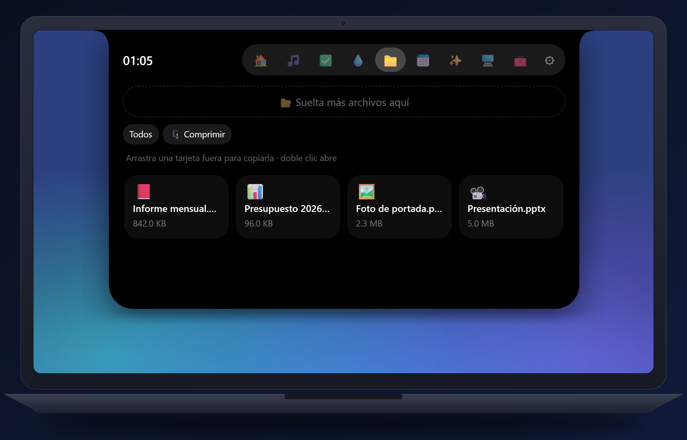<br /><sub><b>Archivos</b> · suéltalos, arrástralos, comprime y más</sub></td>
<td align="center" width="50%">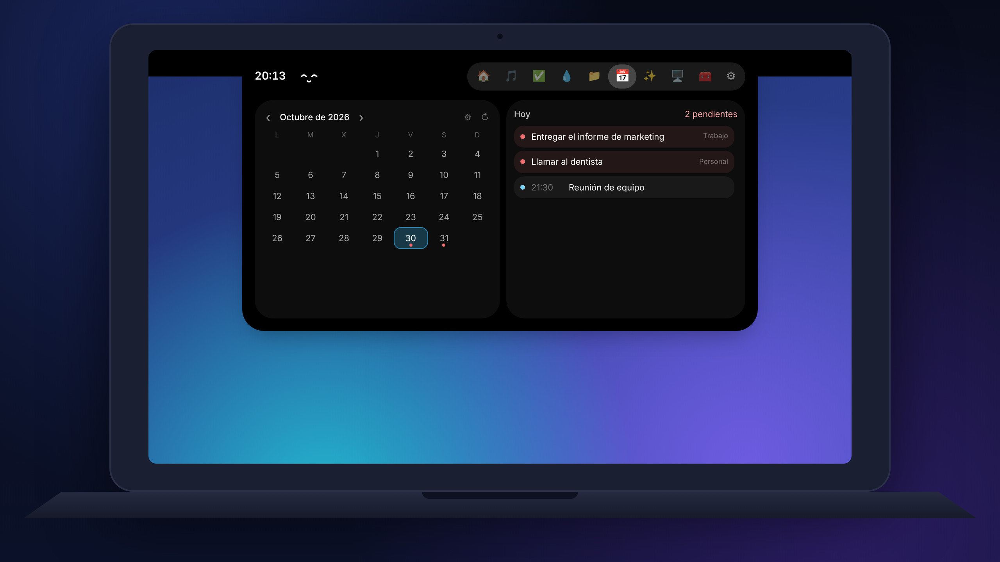<br /><sub><b>Calendario</b> · tus tareas y eventos del mes</sub></td>
</tr>
<tr>
<td align="center" width="50%">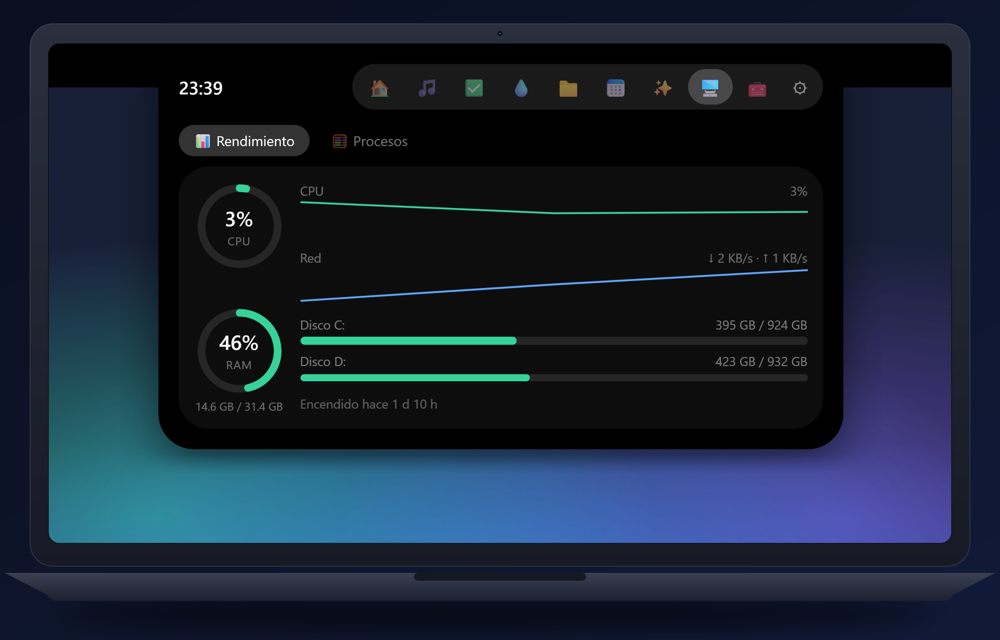<br /><sub><b>Sistema</b> · CPU, RAM, discos y red</sub></td>
<td align="center" width="50%">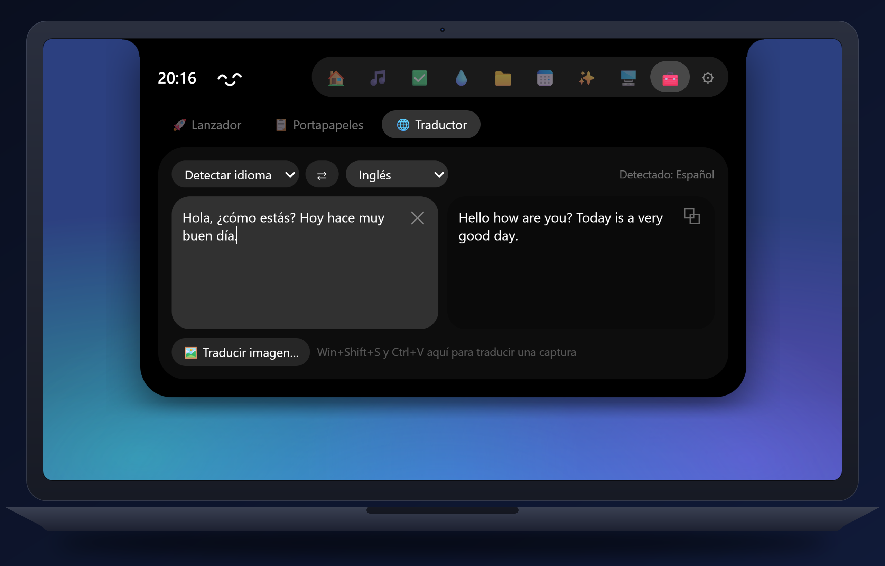<br /><sub><b>Traductor</b> · de texto e imágenes, sin clave de API</sub></td>
</tr>
</table>

## 🧩 Funciones

<table>
<tr>
<td width="50%" valign="top">

**🏠 Panel**
Interruptores de un toque (Wi-Fi, Bluetooth, mantener activo, modo oscuro, micrófono, sonido, No molestar, captura y bloqueo), el clima por horas y días, y tus apps favoritas con sus iconos reales.

**🎵 Música**
Muestra y controla lo que suene (Spotify, YouTube Music, VLC, el navegador…): carátula, barra de progreso, **letras sincronizadas** y un visualizador que reacciona a tu sonido real.

**✅ Agenda**
Tareas con fecha, hora y categoría. Escribe «llamar 15m» o «reunión 14:30» y las entiende. Incluye notas rápidas y un **Pomodoro**.

**💧 Hábitos**
Tomar agua, la pastilla, caminar… con meta diaria, **rachas** y recordatorios. Activa o pausa cada hábito.

**📁 Archivos**
Suelta archivos en el notch para guardarlos; arrástralos de vuelta, comprímelos, extráelos, cópialos, muévelos o mándalos a la papelera.

</td>
<td width="50%" valign="top">

**📅 Calendario**
Vista mensual con tus tareas y eventos de Google, Outlook o cualquier enlace iCal, y avisos antes de las reuniones.

**✨ Chat de IA**
Un chat rápido para dudas y respuestas breves (Gemini, Claude, compatibles con OpenAI u Ollama local). Sigue respondiendo en segundo plano. Usas tu propia clave.

**🌐 Traductor**
Traduce texto mientras escribes y **también imágenes** (con el OCR de Windows, en tu PC). No necesita clave de API.

**🖥️ Sistema**
CPU, RAM, discos y red en tiempo real, y los programas que más consumen, con botón para cerrarlos.

**⏱️ Tiempo de pantalla**
*Opcional, apagado por defecto.* Cuánto usas cada app, solo en tu PC.

**🔔 Avisos y más**
Volumen, brillo, cargador, batería baja, internet, Bloq Mayús, recordatorios de salud, un notch por pantalla y actualizaciones firmadas.

</td>
</tr>
</table>

## 🚀 Primeros pasos

1. **Descarga** `Noki_<versión>_x64-setup.exe` desde [Releases](../../releases/latest) y ejecútalo. Se instala solo para tu usuario (no pide administrador). Si falta Microsoft Edge WebView2, el instalador lo descarga.
2. **Abre Noki** desde el menú Inicio. Verás un pequeño notch arriba, en el centro de tu pantalla, y su icono en la bandeja (clic izquierdo = Ajustes, clic derecho = menú).
3. **Pasa el cursor por encima** o pulsa **`Alt+N`** para abrirlo. Haz clic en los iconos de arriba para cambiar de pestaña.
4. Abre **Ajustes** (⚙) para activar o apagar módulos, elegir el idioma, cambiar su aspecto y conectar tu calendario, tu ciudad o tu clave de IA.

> **Aviso de Windows SmartScreen:** el instalador todavía no está firmado con un certificado de pago, así que Windows puede mostrar «Windows protegió su PC». Es normal: elige **Más información → Ejecutar de todas formas**. Si prefieres no hacerlo, puedes [compilarlo tú mismo](#-compilar-desde-el-código).

Tus ajustes se guardan en `%APPDATA%\com.noki.app`. Si vienes de «Mi Notch» (el nombre anterior), Noki copia tus ajustes, datos y claves la primera vez que se abre; después puedes desinstalar la versión vieja.

## 🎨 Hazlo tuyo

En **Ajustes → Apariencia** puedes:

- Elegir el **icono de Noki** entre cinco degradados (bandeja y ventana de Ajustes).
- Dejar o quitar el **personaje**: la carita del notch parpadea y mira tu cursor, se alegra al terminar una tarea, un hábito o un Pomodoro, baila con la música, se sorprende si le haces clic (y se marea si le haces muchos), abre la boca al soltar un archivo y se adormece de noche o con poca batería.
- Elegir el **color** del notch o ponerle una **imagen** de fondo.
- Activar el **color automático**: toma el color del programa que tengas abierto debajo y cambia con él.
- Rellenar la **franja a los costados** del notch para que parezca una sola pieza (igual que el notch, transparente, un color, una imagen o automática).
- Decidir **qué se ve cuando está cerrado**: hora, fecha, tareas pendientes, hábitos del día, temperatura, batería y lo que suena.
- Ajustar tamaños, posición, opacidad y reloj de 12 o 24 horas.
- Poner un **tema de temporada** (Halloween, Navidad, Cumpleaños o Amor), por separado en la cara de Noki, el notch central y la franja de los costados. Con «Automático» se activan solos según la fecha.

<table>
<tr>
<td align="center" width="50%">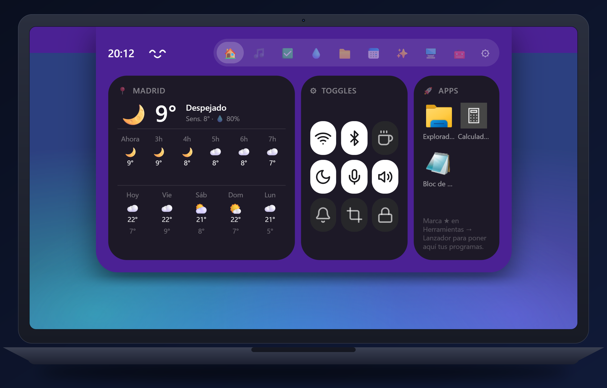<br /><sub><b>Un color</b> · el notch y la franja a juego</sub></td>
<td align="center" width="50%">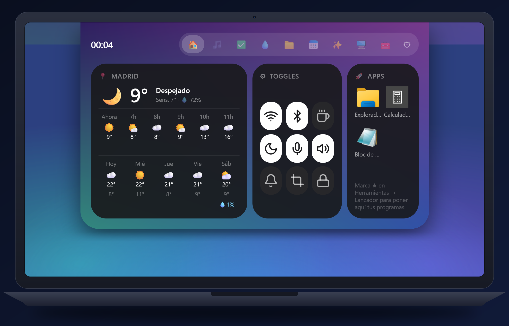<br /><sub><b>Una imagen</b> · de fondo en el notch y en la franja</sub></td>
</tr>
<tr>
<td align="center" width="50%">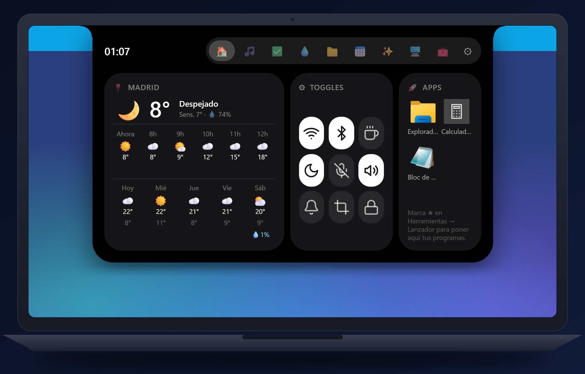<br /><sub><b>La franja a tu gusto</b> · los costados del notch pueden ser de otro color, una imagen o transparentes</sub></td>
<td align="center" width="50%">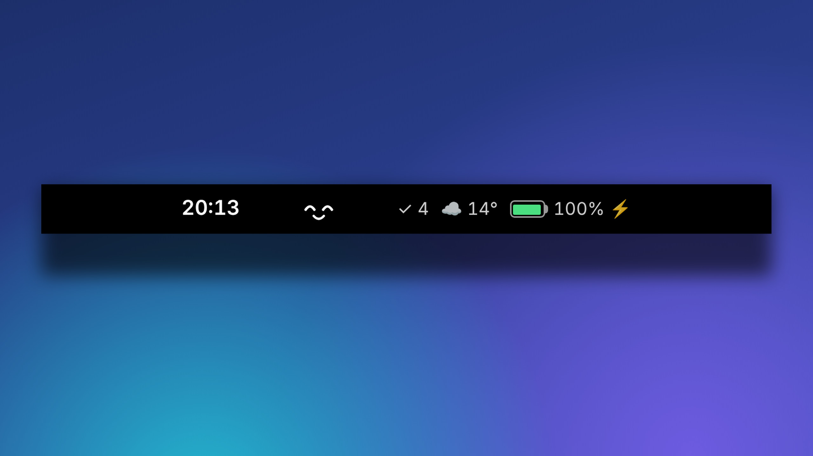<br /><sub><b>Cerrado</b> · hora, tareas, hábitos, clima, batería y lo que suena</sub></td>
</tr>
</table>

### 🎭 Temas de temporada

Cada tema viste a Noki, pinta el notch y llena la franja de los costados con sus adornos. Eliges **por separado** la cara, el notch central y la franja (por ejemplo Noki de Amor, notch de Halloween y costados de Navidad), la transparencia del color y puedes añadir tus **propias fechas**. Con **Automático** cambian solos: Halloween (24 oct–2 nov), Navidad (1–26 dic), Amor (7–14 feb) y Cumpleaños el día que indiques. También puedes **exportar e importar** tu apariencia en un archivo.

<table>
<tr>
<td align="center" width="50%"><br /><sub><b>Halloween</b> · bruja, calabazas, murciélagos, telarañas y calaveras</sub></td>
<td align="center" width="50%">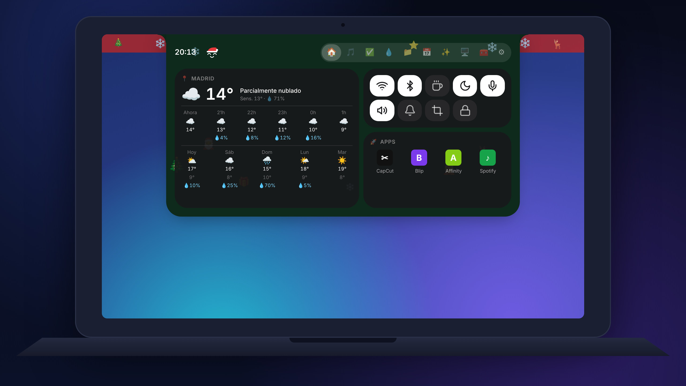<br /><sub><b>Navidad</b> · gorro de Papá Noel, renos, duendes y copos</sub></td>
</tr>
<tr>
<td align="center" width="50%">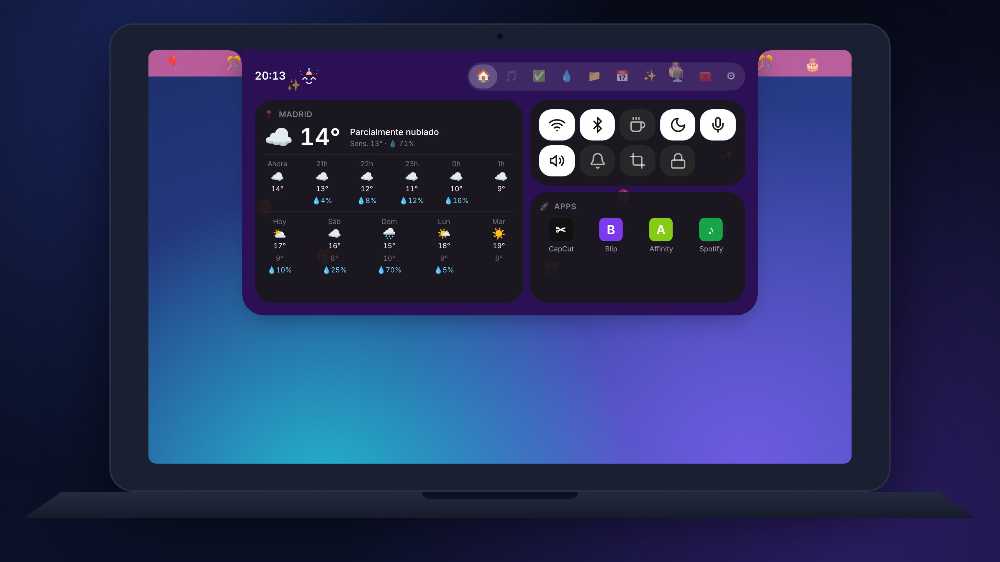<br /><sub><b>Cumpleaños</b> · gorro de fiesta, globos, tarta y confeti</sub></td>
<td align="center" width="50%">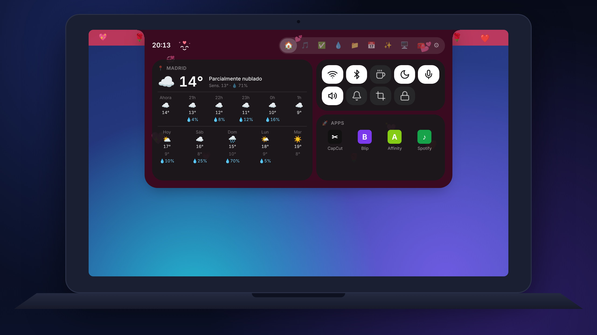<br /><sub><b>Amor</b> · ojitos de corazón, corazones y rosas</sub></td>
</tr>
<tr>
<td align="center" width="50%">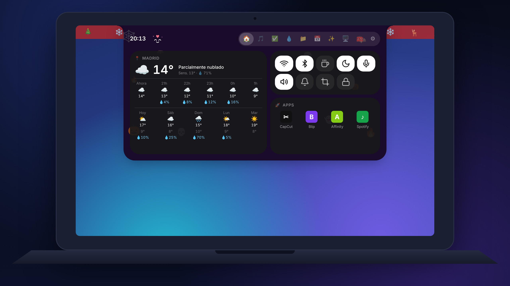<br /><sub><b>Mezclados</b> · cara de Amor, notch de Halloween y costados de Navidad</sub></td>
<td align="center" width="50%">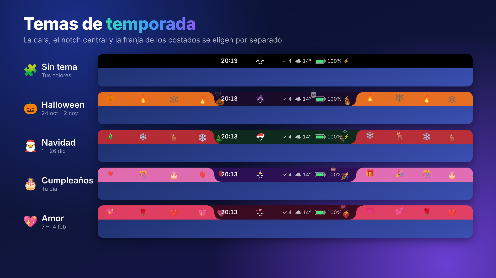<br /><sub><b>Comparativa</b> · los cuatro temas con el notch cerrado</sub></td>
</tr>
</table>

> Las imágenes de esta sección son ilustraciones generadas con los mismos componentes de la app; el aspecto real puede variar un poco según tu pantalla y fondo.

### 🎙 Grabadora de voz

En **Agenda → Grabadora** grabas tu voz y los audios se quedan guardados **solo en tu PC**. Puedes buscar dentro de los nombres y de las transcripciones, **transcribir** un audio de forma local y gratis (modelo Whisper, se descarga una vez), pasar el texto a **Notas** o **Tareas**, y exportar el audio o el texto. Elige micrófono y calidad con el engranaje ⚙. Con el atajo `Alt+R` empiezas y detienes la grabación desde cualquier programa, y el notch cerrado muestra un punto rojo con el tiempo.

<table>
<tr>
<td align="center" width="50%">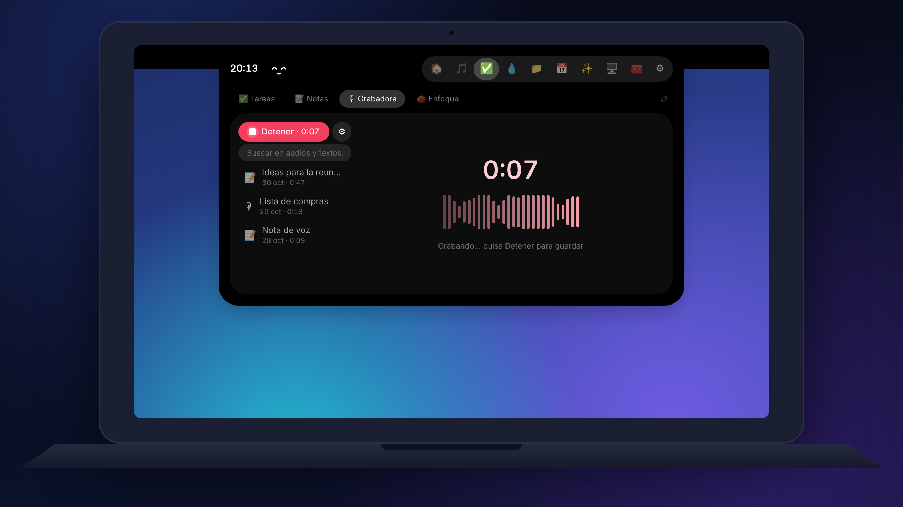<br /><sub><b>Grabando</b> · cronómetro y onda en vivo</sub></td>
<td align="center" width="50%">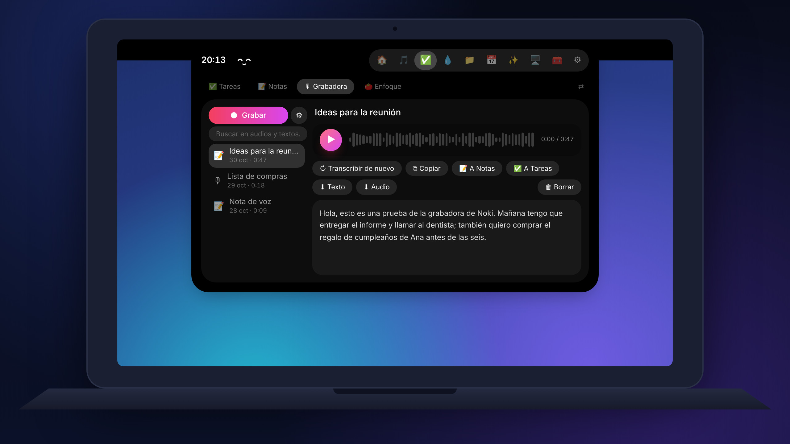<br /><sub><b>Transcripción</b> · reproduce, copia, exporta o pásala a Notas y Tareas</sub></td>
</tr>
<tr>
<td align="center" width="50%">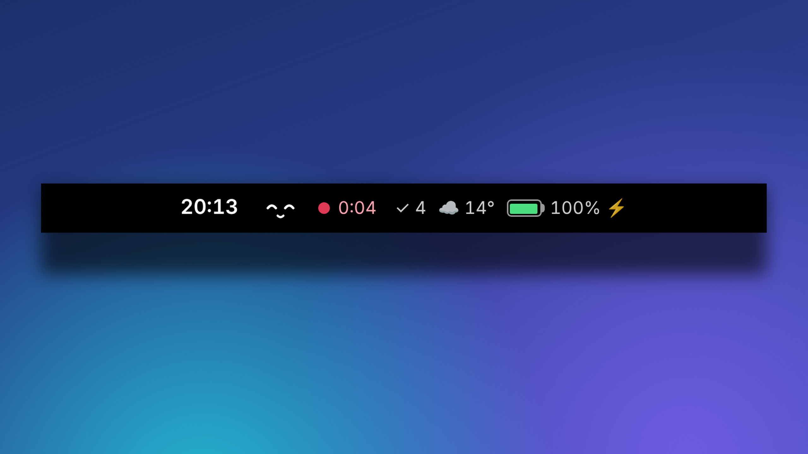<br /><sub><b>Con el notch cerrado</b> · un punto rojo y el tiempo</sub></td>
<td align="center" width="50%">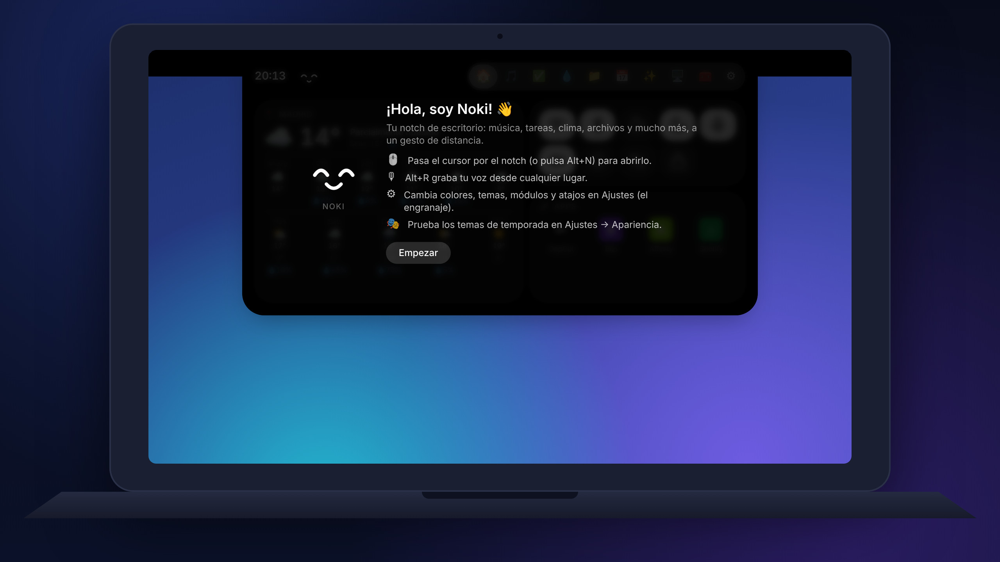<br /><sub><b>Bienvenida</b> · Noki se presenta la primera vez</sub></td>
</tr>
</table>

### ⌨️ Atajos configurables

En **Ajustes → Atajos** cada atajo global se puede **cambiar y encender o apagar** para que no choque con otros programas: abrir/cerrar el notch (`Alt+N`), grabar voz (`Alt+R`), No molestar, tarea rápida y saltar directo a una pestaña (`Alt+1…9`).

<div align="center">
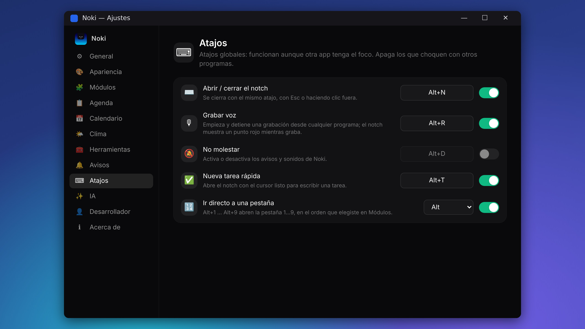
</div>

### 🧩 Widgets a un gesto

<div align="center">
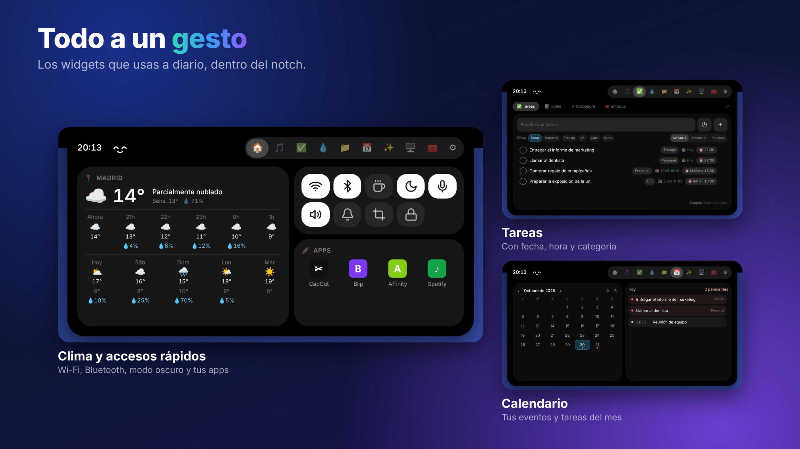
</div>

## 🔌 Y mucho más

- **Calendarios por enlace.** Añade cualquier calendario que te dé una dirección `.ics` o `webcal://`. En Google Calendar: Configuración → tu calendario → «Integrar calendario» → «Dirección secreta en formato iCal». En Outlook: Configuración → Calendario → Calendarios compartidos → «Publicar un calendario». Son de solo lectura y se actualizan cada 15 minutos.
- **Copia de seguridad.** En Ajustes → Acerca de puedes **exportar** tus ajustes y datos (tareas, notas, hábitos, chat…) a un archivo y **importarlos** en otro equipo. No incluye las claves de API.
- **Chat de IA a tu manera.** Elige Gemini, Claude, un servicio compatible con OpenAI u Ollama en tu propio equipo. Las claves se guardan en el Administrador de credenciales de Windows.
- **Un atajo para todo.** `Alt+N` abre y cierra el notch (puedes cambiarlo en Ajustes → Atajos).
- **Avisos útiles.** Volumen, brillo, cargador, batería baja, internet, Bloq Mayús y recordatorios de salud, cada uno con su interruptor.
- **Varias pantallas.** Un notch por monitor, y se oculta solo cuando algo va en pantalla completa.

## 🔐 Privacidad

Todo se queda en tu PC. Noki solo se conecta a internet cuando usas algo que lo necesita:

| Función | Servicio | Cuándo |
|---|---|---|
| Clima | [Open-Meteo](https://open-meteo.com) | si eliges una ciudad |
| Traducción de texto | Servicio web de Google Translate (punto de acceso no oficial) | mientras traduces |
| Texto de imágenes (OCR) | OCR de Windows, **local** | nada sale de tu PC |
| Transcripción de voz (opcional) | [Hugging Face](https://huggingface.co): solo **descarga** el modelo Whisper una vez; el audio se procesa en tu PC | la primera vez que transcribes |
| Letras | [LRCLIB](https://lrclib.net) | al abrir las letras |
| Detectar mi ciudad | [ipwho.is](https://ipwho.is) | solo al pulsar el botón |
| Chat de IA | el proveedor que elijas, con *tu* clave | al enviar un mensaje |
| Calendarios | los enlaces iCal que añadas | cada 15 minutos |
| Actualizaciones | GitHub Releases | al abrir y cada 6 h, si está activado |

## 🛠️ Compilar desde el código

Requisitos: Windows 10/11, [Node.js 20+](https://nodejs.org), [Rust (estable)](https://rustup.rs) y las Visual Studio Build Tools con la carga «Desarrollo de escritorio con C++».

```bash
npm install
npm run tauri dev      # modo desarrollo con recarga
npm run tauri build    # genera el instalador NSIS
```

Pruebas: `cd src-tauri && cargo test --lib`. Para publicar versiones con actualizaciones automáticas mira [docs/RELEASING.md](docs/RELEASING.md) (**nunca subas tu clave privada de firma**).

<details>
<summary><b>Cómo funciona por dentro</b></summary>

- Una ventana transparente de tamaño fijo por pantalla; un hilo de Rust lee el cursor cada 25 ms para decidir el click-through, abrir y cerrar al pasar el cursor y ocultarse en pantalla completa.
- Con «Reservar espacio» se registra como AppBar de Windows, así las ventanas maximizadas quedan debajo del notch.
- Interfaz en React 18 + Tailwind, que habla con Rust mediante comandos y eventos de Tauri 2.

| Ruta | Qué hace |
|---|---|
| `src-tauri/src/notch.rs` | Posición, AppBar, click-through, hover y pantalla completa |
| `src-tauri/src/dropzone.rs` | Destino nativo para arrastrar archivos al notch |
| `src-tauri/src/quick.rs` | Interruptores del Panel |
| `src-tauri/src/settings.rs` | Ajustes tipados, validación y guardado atómico |
| `src/App.jsx` | El notch (forma, pestañas, animación) |
| `src/components/SettingsWindow.jsx` | La ventana de Ajustes |
| `src/lib/en.js` | Traducciones al inglés |

</details>

## 🤝 Contribuir

Los reportes de errores y las ideas son muy bienvenidos: abre un [issue](../../issues/new/choose), conversa en [Discussions](../../discussions) o lee [CONTRIBUTING.md](CONTRIBUTING.md).

## 💛 Apoya el proyecto

Noki es gratis. Si te gusta, puedes **[invitarme un café en Ko-fi](https://ko-fi.com/cristhianbillybustamante)** ☕ o simplemente seguirme:

[Instagram](https://www.instagram.com/cristhian.billy/) · [Facebook](https://www.facebook.com/cristhian.bustamanteespinoza/) · [X](https://x.com/Cristhian_0702)

## 🙏 Créditos

- Hecho por **Cristhian Bustamante** con ayuda de IA ([Claude Code](https://claude.com/claude-code)).
- Inspirado en el notch de las laptops Mac y en las apps de «notch» para escritorio: gracias a esa idea me animé a hacer mi propia versión.
- Construido sobre software de código abierto, mira [THIRD-PARTY-NOTICES.md](THIRD-PARTY-NOTICES.md).

## 📄 Licencia

Copyright © 2026 Cristhian Bustamante. Noki es software libre: puedes redistribuirlo y modificarlo bajo los términos de la [Licencia Pública General de GNU v3.0 o posterior](LICENSE). Se ofrece **sin garantía**.

<div align="center">
<br />
<sub>Hecho con ☕ y mucho cariño · Si Noki te sirve, ¡regálale una ⭐ al repositorio!</sub>
</div>
